# Saklolo — Wireframes

Low-fidelity wireframes for every screen and state in [USER-FLOW.md](USER-FLOW.md): 66 phones in eleven groups, including proposed quick triggers and confirmations. Requirements are in [PRD.md](PRD.md); the screen list comes from the [project brief](references/saklolo-project-brief.md). Names, numbers and times are sample data.

Tags on each wireframe: **MUST**, **WOW**, **STRETCH** (the tiers from the brief) and **TBD** (the sources don't decide it, so the wireframe shows a proposal).

Full sheet: [wireframes/wireframes.png](wireframes/wireframes.png). Source: [wireframes/wireframes.html](wireframes/wireframes.html).

## A. Launch (proposed)

The first screen on every open: a plain splash that never waits for the model (A1). On first launch it is followed by four Welcome slides that explain how the app works (A2 to A5). Skip is on slides 1 to 3 and goes straight to Get started; slide 4 ends with the Get started button. A thin strip shows the model loading in the background.

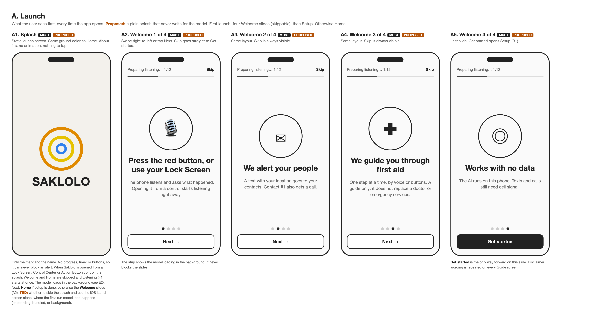

## B. Setup (first launch)

Four steps, one question per screen: name (B1), emergency contacts with #1 marked as the one who gets the call (B2), permissions (B3), and an optional quick-trigger setup (section C). A thin strip shows the model preparing in the background. Also the add-contact sheet with "Import from Contacts" (B4) and permission-denied (B5). Added after [finding 004](findings/004-whisperkit-transcription.md): the speech model is a 632 MB download that takes about 3 minutes to prepare on first run.

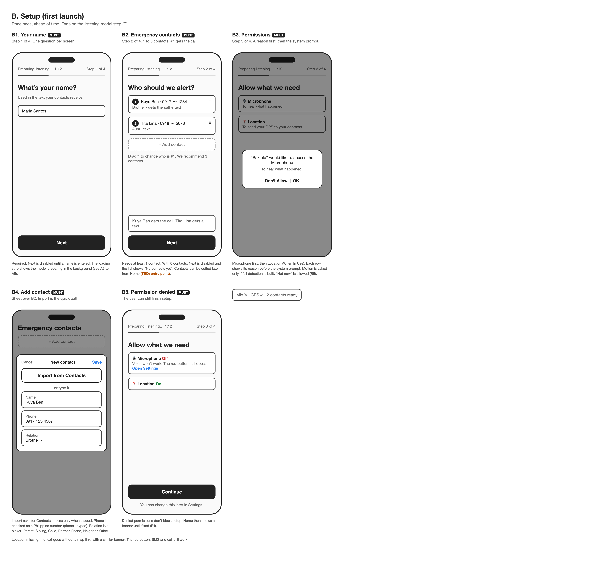

## C. Quick trigger setup (proposed)

An optional fourth onboarding step, always skippable and available later from the Home menu. It offers the quick triggers (C1), guides the user to add the "Saklolo" Shortcut (C2), then the control on the Lock Screen (C3), Control Center (C4) or Action Button (C5), and ends with a test text to contact #1 (C6). iOS does not let an app add its own control, so C3 to C5 are instructions with a picture of the result. Whether the trigger works on a locked phone is still unverified (spikes 003 and 008).

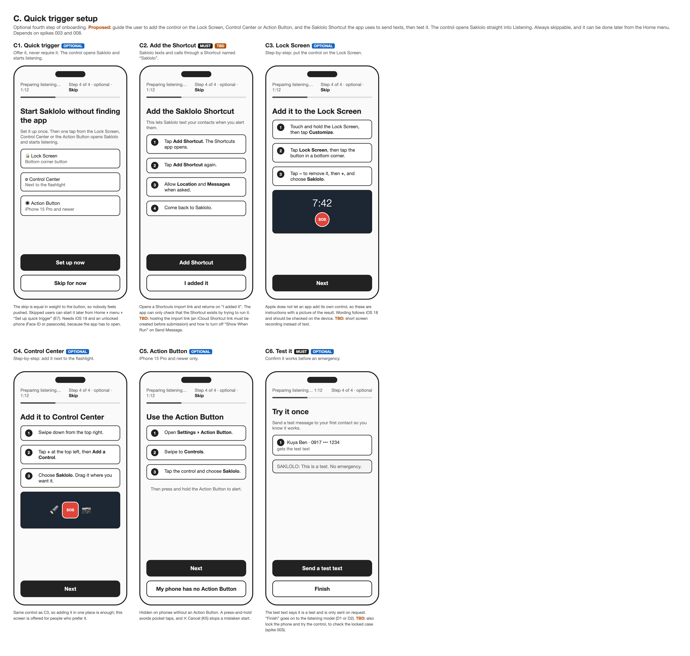

## D. Listening model (proposed)

The last onboarding step. The speech model starts loading at the splash and runs during setup, so this step may already be done. The Home screen sits faded behind a status card: a real bar for the download (D1), an indeterminate, labelled wait for the prepare phase (D2), a "taking longer than usual" state (D3), Ready (D4) and Failed (D5). D6 lists the draft tips. "Continue now" is always available, because the alert never waits on the model. Based on [finding 004](findings/004-whisperkit-transcription.md) and Apple\'s progress-indicator guidance.

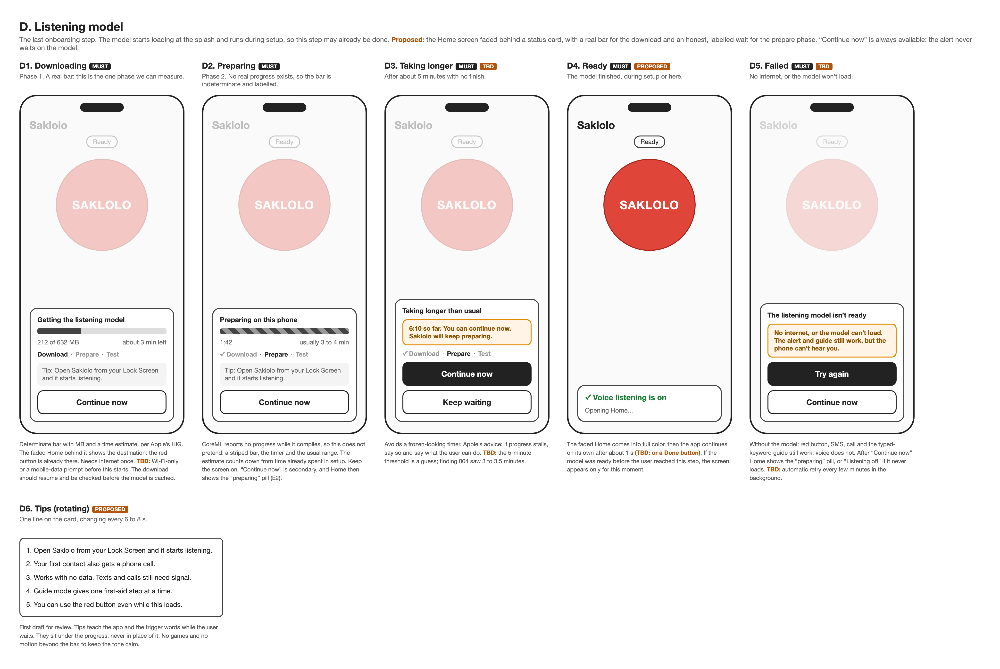

## E. Home

Home (E1) and its states: preparing the model (E2), model failed (E3), microphone off (E4), location off (E5) and no contacts (E6). The pill says whether voice works, the readiness line says what the alert has, and one banner shows at a time, most severe first: no contacts, microphone off, model failed or loading, location off. The gear opens the menu (E7): contacts, permissions, past incidents, set up quick trigger, a test alert and the disclaimer.

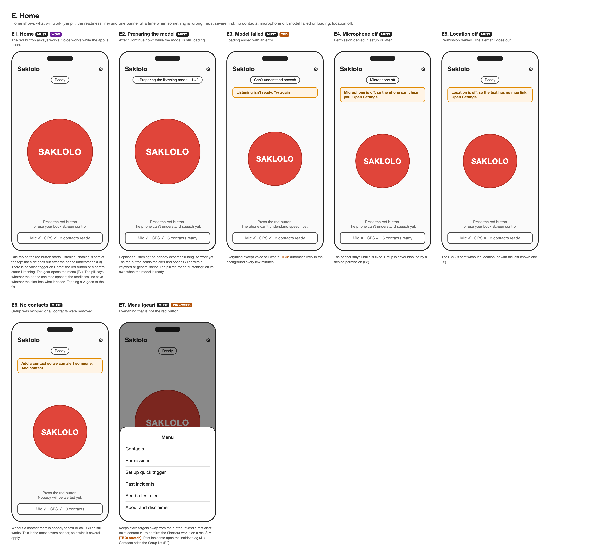

## F. Listening and understanding (proposed)

One continuous screen. Tapping the red button turns it into a voice orb at the bottom and opens a chat above it (F1). Nothing is sent or announced at the tap, so the user is not alarmed. A quiet ✕ Cancel in the header stops a mistaken start (F1). The user's words appear as a bubble once transcription finishes (F2), then pre-written replies fill in with what the local model picked: who, what happened, and the mode. The single alert text goes out here and appears in the thread as "I've told ...", with its text (F3). A "Not right?" sheet corrects the situation and who is hurt (F4), a failure state never dead-ends (F5), and "Type instead" covers when speaking is not possible (F6). F7 shows how the answer is chosen: the keyword classifier runs first, the local model picks mode, situation and script, and the replies and first-aid scripts are fixed. The model never writes free text. WhisperKit transcribes after recording stops, so words cannot appear while the user is speaking.

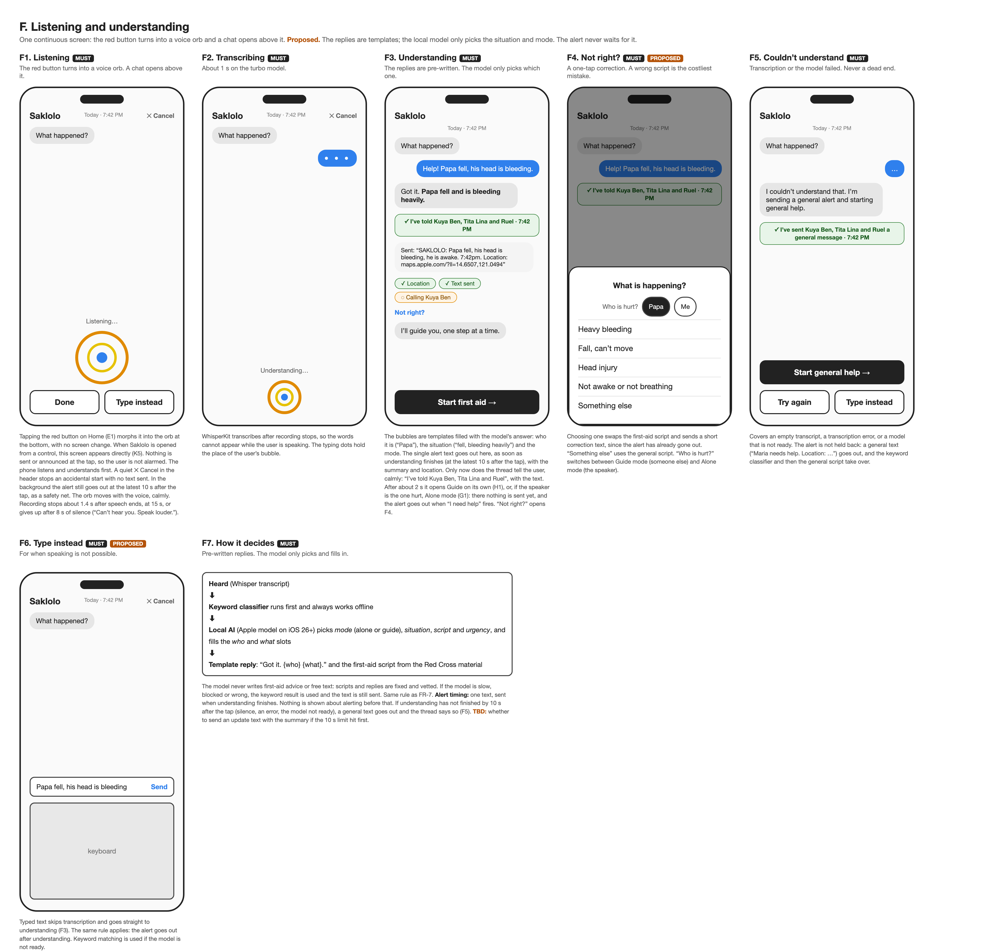

## G. Alone mode

The injured person is speaking ("I fell"). It is the same chat as F3, in large type. Nothing is sent at understanding. A dock at the bottom holds both controls: **I need help** is a countdown bar (10 s, TBD) that fires on its own, or when tapped, and only then sends the alert text; **I\'m okay** is a slide that cancels it, so a stray touch cannot. The phone checks in (G1). When "I need help" fires the text goes out and first aid follows in the same thread (G2). If nobody answers it asks again louder at 30 s (G3), then re-texts every contact and calls contact #2 at 60 s (G4). Sliding "I\'m okay" before the text goes sends nothing (G5); after it, the person can tell the contacts (G6). It works without voice (G7), and the call confirm is a fallback (G8). Guide mode, where someone else is hurt, still sends after understanding. The sources list no dedicated screen, so all of this is a proposal.

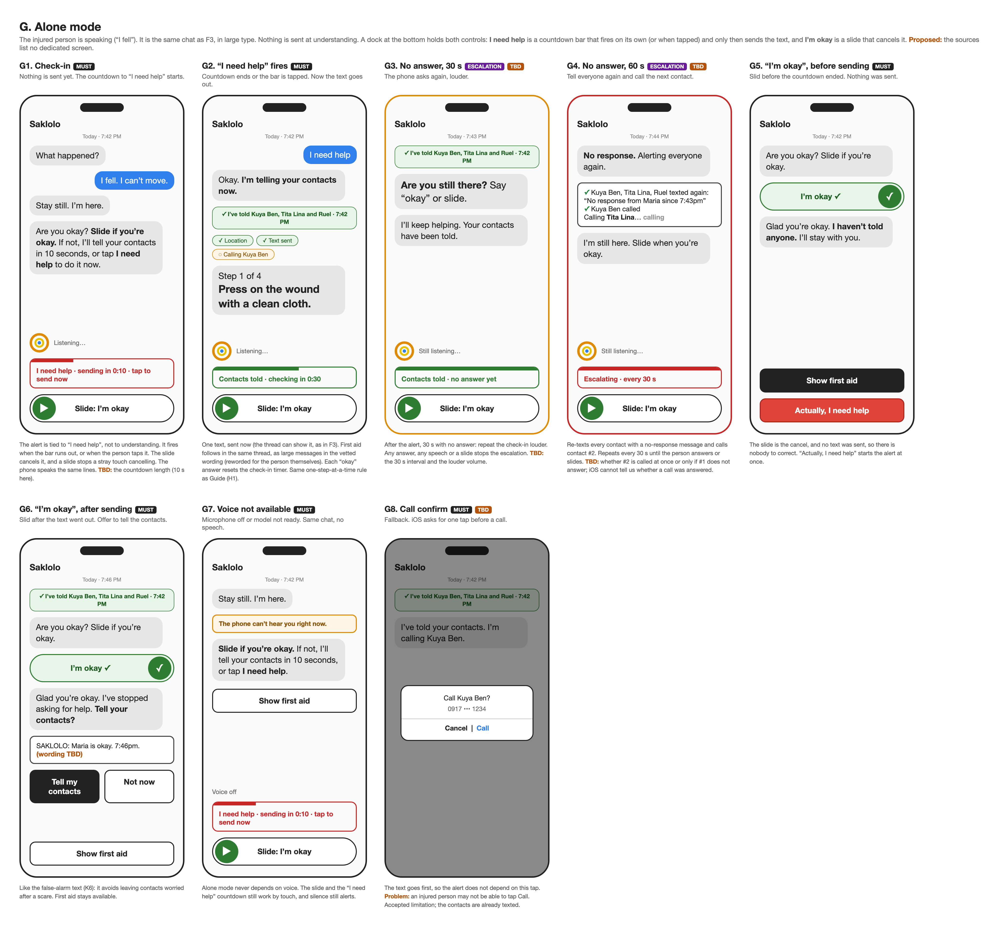

## H. Guide mode

A companion is speaking ("Papa fell"). The first-aid steps live in a bottom sheet over the chat, with three heights: peek (H2), half (H1, the default) and full (H3, all steps plus "Not right?" and "Call 911"). The chat stays visible behind it, with times on the thread, so the user still sees what is going on: the alert, the calls and any reply. The sheet never closes fully. CPR (H4, H5) starts only after the user confirms the person is not breathing, and stopping needs a press-and-hold. The general script (H6) and the end of the script (H7) use the same sheet. The scripts are the same fixed, vetted ones; only the layout changed.

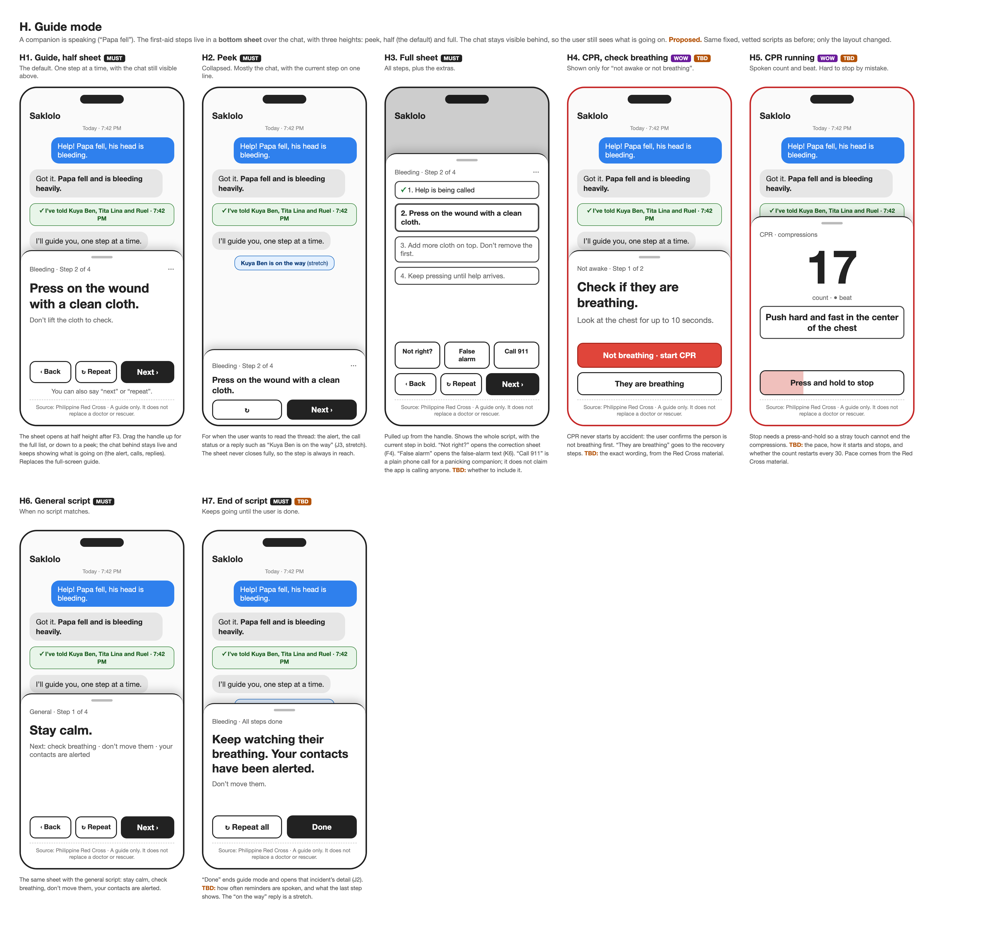

## I. Fallbacks

The app always tries to alert. When it cannot send, it says so in the chat, queues or adapts the text, and keeps guiding. Cards in the chat replace pop-ups, so the guide stays visible: "I couldn\'t send the text by myself" (I1) leads to the message composer (I2); no signal queues the text and retries (I3); no location sends the last known one, labelled (I4). I5 lists every failure and what happens. The promise is "the app always tries", not "the alert is sent in every case", because with no signal it cannot be.

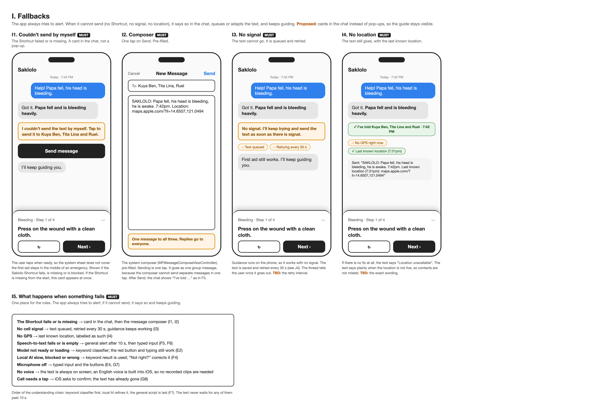

## J. Incident log and the contact's side

The incident log: a list of past incidents, newest first (J1), the detail of one incident with a timeline and the per-contact status (J2), an empty state (J3) and a delete confirm (J4). Then what the contact sees (J5), the contact\'s reply (J6, stretch, and iOS cannot read incoming SMS, so it needs a Shortcuts automation) and the queued state (J7). Reached from Home ▸ menu ▸ Past incidents; after a guide or alone session ends the app opens that incident\'s detail. Everything is stored on this phone only, no audio is kept, and the user can delete one incident or all of them.

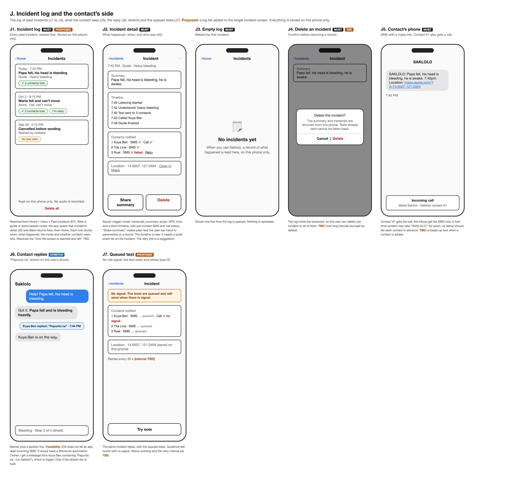

## K. Entry points and false alarm (proposed)

Ways to start Saklolo from outside the app, all of which open it straight into Listening (F1) with no red-button tap and need an unlocked phone: the Saklolo control on the Lock Screen (K1), in Control Center (K2) and on the Action Button, the Home Screen widget (K3), and an optional "Hey Siri, Saklolo" (K4). The control is labelled "Saklolo" with our mark, not "SOS", so it is not mistaken for Apple\'s Emergency SOS. A quiet "✕ Cancel" stops a mistaken start with no text sent (K5). One false-alarm flow tells the contacts it was a mistake, from the Guide sheet or from Alone mode, with wording that fits the mode (K6). Fall and shout detection are stretch ideas that would enter Alone check-in (G1); they have no screen of their own. Not in the original brief.

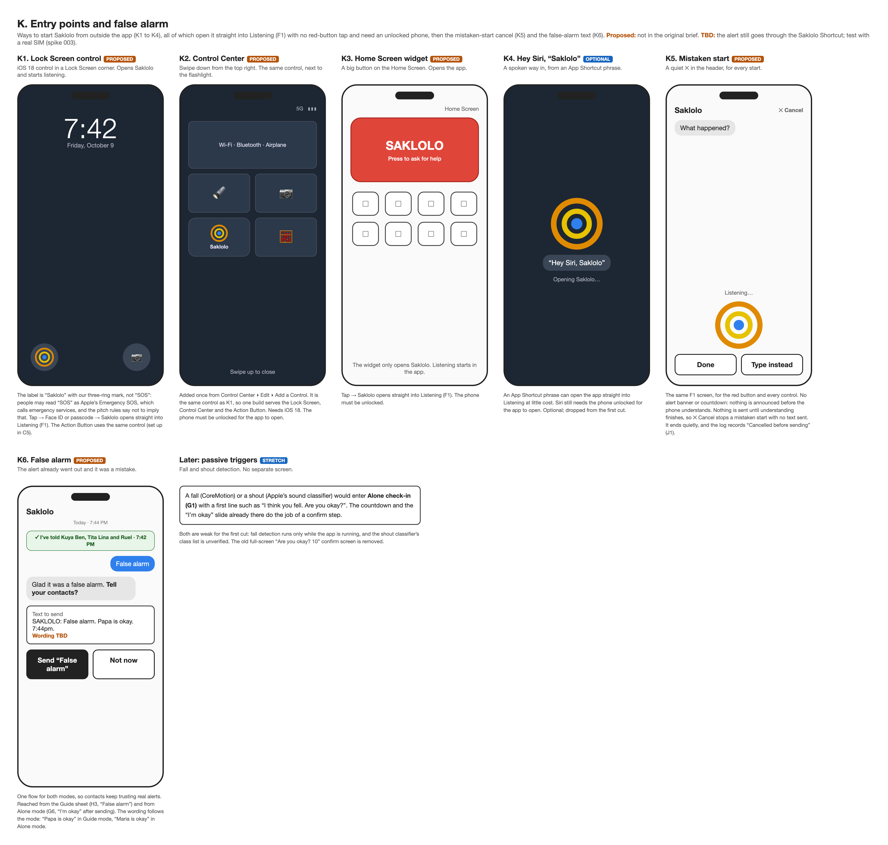

## Screen map

| From | To | When |
| --- | --- | --- |
| Splash (A1) | Home (E1) | Setup is done (model keeps loading in the background) |
| Splash (A1) | Welcome (A2) | First launch |
| Welcome (A2 to A4) | Setup (B1) | Skip |
| Welcome (A5) | Setup (B1) | Get started |
| Name (B1) | Contacts (B2) | Name entered |
| Contacts (B2) | Add contact (B4) | Add contact tapped |
| Contacts (B2) | Permissions (B3) | At least 1 contact |
| Permissions (B3, B5) | Quick trigger (C1) | Continue; denied permissions do not block (banner on Home, E4) |
| Quick trigger (C1) | Add the Shortcut (C2) | Set up now |
| Quick trigger (C1) | Listening model (D1, D2 or D4) | Skip for now |
| Add the Shortcut (C2) | Lock Screen (C3), Control Center (C4), Action Button (C5), then Test (C6) | Steps in order; each can be skipped |
| Test (C6) | Listening model (D1, D2 or D4) | Finish |
| Ready (D4) | Home (E1) | Automatically after about 1 s |
| Downloading, Preparing (D1, D2) | Home (E1) | Self-test passes |
| Preparing (D2) | Taking longer (D3) | About 5 minutes with no finish |
| Loading, Taking longer or Failed (D1, D2, D3, D5) | Home, preparing the model (E2) | "Continue now" tapped before the model is ready |
| Home (E1) | Menu (E7) | Gear tapped |
| Home (E1) | Listening (F1) | Red button tapped. A control (K1 to K4) skips Home and opens F1 directly |
| Listening (F1) | Transcribing (F2) | Recording ends (speech ends, 15s max) |
| Listening (F1) | Type instead (F6) | "Type instead" tapped |
| Transcribing (F2) | Understanding (F3) | Transcript ready |
| Transcribing (F2) | Couldn't understand (F5) | Empty transcript or error |
| Understanding (F3) | Guide (H1) | Mode is guide, after about 2 s |
| Understanding (F3) | Alone (G1) | Mode is alone |
| Understanding (F3) | Not right? (F4) | "Not right?" tapped |
| Check-in (G1) | "I need help" fires (G2) | Countdown ends or the bar is tapped |
| Check-in (G1) | "I'm okay" before sending (G5) | Slide completed before the text goes |
| "I need help" fires (G2) | No answer, 30 s (G3) | No answer after the alert |
| No answer, 30 s (G3) | Still no answer, 60 s (G4) | Still no answer |
| After the text (G2 to G4) | "I'm okay" after sending (G6) | Slide completed |
| Guide (H7) or Alone (G1 to G6) | Incident detail (J2) | Done tapped, or the session ends |
| Incident detail (J2) | Incident log (J1) | Back |
| Incident log (J1) | Home (E1) | Back |
| Home menu (E7) | Incident log (J1) | Past incidents |
| Incident log (J1) | Incident detail (J2) | Row tapped |
| Incident detail (J2) | Delete confirm (J4) | Delete tapped |
| Lock Screen control, Control Center control, Action Button, widget (K1 to K4) | Listening (F1) | Control tapped and phone unlocked; one alert text goes out when understanding finishes (10 s at the latest) unless cancelled with ✕ |
| Guide sheet menu (H3) or Alone, after sending (G6) | False alarm text (K6) | User chooses to tell contacts |

## Not decided in the sources (TBD)

- **Shortcut sending:** whether the Saklolo Shortcut sends SMS and places the call without extra taps once the app is open (spike 003). The control needs an unlocked phone either way.
- **Confirm window** (10s), **safety limit** (10 s), **retry interval** and **false-alarm wording**.
- **Alone mode:** the countdown length, the escalation timing (30 s), the louder volume, whether contact #2 is called at once or only if #1 does not answer, and the "Maria is okay" wording.
- **Call confirm:** `tel://` needs one tap, which an injured person may not be able to give.
- **CPR mode:** pace, layout, and how it starts and stops.
- **Source and disclaimer:** where they sit on screen. The Guide wireframes show a footer.
- **Retention:** how long incident records are kept by default.
- **First-run model load:** do it at onboarding, bundle the model in the app, or accept the wait (D2). What Home and the user see if the model never loads (D3, E2).
- **Listening thresholds:** the stop-after-silence time (1.4 s) and level (-38 dB) are guesses, untested in noise.
- **Permissions:** whether prompts appear at first launch or first use.
- **Reminders:** how often "help is on the way" is spoken.
- **Suggestions, not in the brief:** the "stop" and "alert now" buttons on Listening, the retry link on a failed SMS, and the empty-state of Setup.
